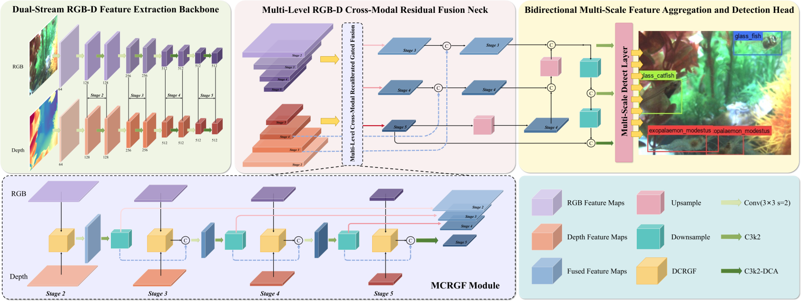
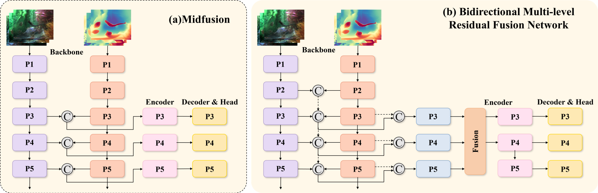
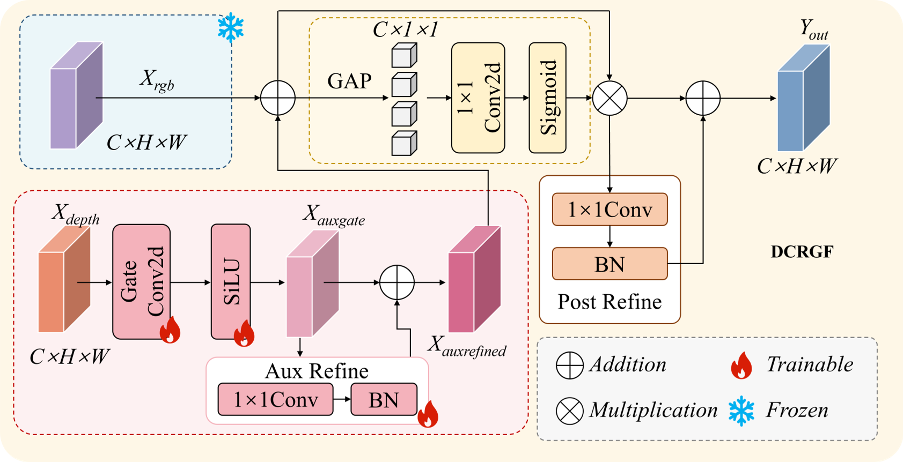
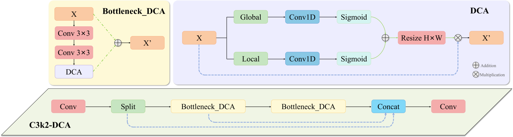
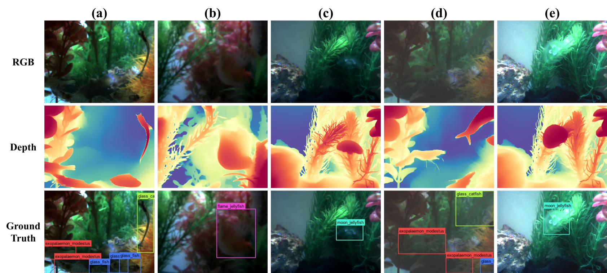
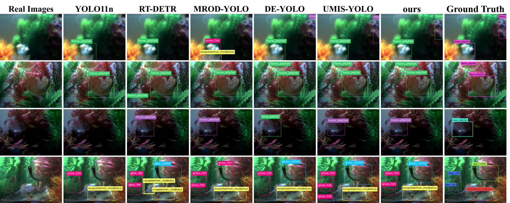

# DUTO-YOLO: Reliability-Aware Depth-Guided RGB-D Fusion for Underwater Transparent Organism Detection

<div align="center">

[](LICENSE)
[](https://www.python.org/)
[](https://pytorch.org/)

**Official implementation of "DUTO-YOLO: Reliability-Aware Depth-Guided RGB-D Fusion for Underwater Transparent Organism Detection"**

</div>

---

## 📖 Abstract

Detecting underwater transparent organisms remains challenging due to low contrast, refraction, scattering, and illumination variation that weaken object boundaries. While estimated depth provides complementary foreground–background structure, it is non-metric and may contain domain-dependent errors. 

**DUTO-YOLO** is a detector based on YOLO11 that processes RGB images and aligned pseudo-depth maps from Depth Anything V2. The model incorporates three key components:

- **BMRFN** (Bidirectional Multi-level Residual Fusion Network) for cross-scale information exchange
- **DCRGF** (Depth-Guided Cross-Modal Recalibrated Gated Fusion) module that adaptively suppresses unreliable depth responses
- **C3k2-DCA** (Dual-Context Attention C3k2) blocks that strengthen local contours and global context

On our **TUBD** (Transparent-Underwater-Biology-Depth) dataset, DUTO-YOLO achieves **86.6% mAP@0.5** and **56.0% mAP@0.5:0.95**, surpassing YOLO11n by **4.8** and **5.4** percentage points with only 6.49M parameters and 14.90 GFLOPs.

---

## ✨ Key Features

- **RGB-D Fusion Framework**: First depth-guided detector specifically designed for underwater transparent organism detection
- **Reliability-Aware Fusion**: DCRGF module adaptively suppresses unreliable pseudo-depth responses in reflective regions
- **Multi-Scale Architecture**: BMRFN preserves fine boundary details through bidirectional residual connections
- **Dual-Context Attention**: C3k2-DCA captures both local contours and global scene context
- **Strong Generalization**: Cross-dataset validation on DUO (85.9%), MUOT-3M (60.8%), and SUIM (42.9%)
- **Efficient Design**: Only 6.49M parameters and 14.90 GFLOPs

---

## 🏗️ Architecture

<div align="center">

</div>

### Core Components

#### 1. Bidirectional Multi-level Residual Fusion Network (BMRFN)
- Shallow-to-deep residual accumulation for cross-scale information exchange
- Reverse same-scale skip connections preserve fine boundary details
- Maintains receptive field expansion while retaining spatial precision

<div align="center">

</div>

#### 2. Depth-Guided Cross-Modal Recalibrated Gated Fusion (DCRGF)
- Zero-initialized gating for adaptive depth injection
- Channel recalibration suppresses unreliable depth responses
- Handles reflective regions and transparent boundaries

<div align="center">

</div>

#### 3. Dual-Context Attention C3k2 (C3k2-DCA)
- Lightweight 1D convolutions for local and global channel context
- Strengthens contour evidence and scene semantics
- Distinguishes transparent organisms from similarly colored backgrounds

<div align="center">

</div>

---

## 🚀 Installation

### Prerequisites

- Python >= 3.8
- PyTorch >= 2.0
- CUDA >= 11.8 (for GPU training)

### Setup

1. Clone the repository
```bash
git clone https://github.com/yourusername/DUTO-YOLO.git
cd DUTO-YOLO
```

2. Create a conda environment
```bash
conda create -n duto python=3.8
conda activate duto
```

3. Install dependencies
```bash
pip install -r requirements.txt
```

4. Install Depth Anything V2
```bash
# Follow instructions at https://github.com/DepthAnything/Depth-Anything-V2
pip install depth-anything-v2
```

---

## 📊 Dataset

### TUBD (Transparent-Underwater-Biology-Depth)

We construct TUBD from [Aqua Eye Dataset](https://github.com/lunaWU628/Aqua-Eye-Dataset) with 6,497 RGB–pseudo-depth pairs.

**Dataset Statistics:**
- **Total Images**: 6,497 RGB-D pairs
- **Training Set**: 5,234 pairs
- **Validation Set**: 1,263 pairs
- **Classes**: 5 (Transparent organisms)
- **Augmentation**: Blur and brightness transformations on RGB, aligned depth maps

<div align="center">

</div>

**Class Distribution:**

| Class | Training | Validation | Total |
|-------|----------|------------|-------|
| exopalaemon_modestus | 4977 | 954 | 5931 |
| glass_fish | 3726 | 1731 | 5457 |
| glass_catfish | 4715 | 529 | 5244 |
| flame_jellyfish | 1960 | 526 | 2486 |
| moon_jellyfish | 362 | 101 | 463 |

### Data Preparation

1. Download Aqua Eye Dataset

2. Generate pseudo-depth maps

3. Organize dataset structure
```
DUTO-YOLO/
├── data/
│   └── TUBD/
│       ├── images/
│       │   ├── train/
│       │   └── val/
│       ├── images_depth/
│       │   ├── train/
│       │   └── val/
│       └── labels/
│           ├── train/
│           └── val/
```

### Cross-Dataset Evaluation

We also evaluate on:
- **DUO**: 7,782 RGB images, 4 categories (holothurian, echinus, scallop, starfish)
- **MUOT-3M**: 3 million frames multimodal underwater benchmark
- **SUIM**: Segmentation benchmark converted to detection format

---

## 🔧 Usage

### Training

Train DUTO-YOLO on TUBD dataset:

```bash
python train.py \
    --data configs/TUBD.yaml \
    --cfg configs/duto_yolo.yaml \
    --weights weights/yolo11n.pt \
    --batch-size 16 \
    --epochs 100 \
    --img 640 \
    --device 0
```

**Training Configuration:**
- Batch size: 16
- Epochs: 100
- Image size: 640×640
- Optimizer: Auto (AdamW/SGD)
- Mixed precision: Enabled
- Random seed: 0

### Inference

Run inference on test images:

```bash
python detect.py \
    --weights weights/duto_yolo_best.pt \
    --source data/test/images \
    --depth_source data/test/depth \
    --img 640 \
    --conf 0.25 \
    --iou 0.45 \
    --save_txt \
    --save_conf
```

### Evaluation

Evaluate on validation set:

```bash
python val.py \
    --data configs/TUBD.yaml \
    --weights weights/duto_yolo_best.pt \
    --batch-size 16 \
    --img 640 \
    --task val
```

### Demo

Visualize detections on sample images:

```bash
python demo.py \
    --weights weights/duto_yolo_best.pt \
    --source assets/demo_images \
    --view-img \
    --save-img
```

---

## 📈 Results

### Performance on TUBD

| Model | Params (M) | FLOPs (G) | P | R | mAP@0.5 | mAP@0.5:0.95 |
|-------|------------|-----------|---|---|---------|--------------|
| YOLO11n | 2.59 | 6.47 | 0.836 | 0.752 | 0.818 | 0.506 |
| **DUTO-YOLO** | **6.49** | **14.90** | **0.864** | **0.793** | **0.866** | **0.560** |
| **Improvement** | - | - | **+2.8** | **+4.1** | **+4.8** | **+5.4** |

### Cross-Dataset Generalization

| Dataset | YOLO11n | DUTO-YOLO | Gain |
|---------|---------|-----------|------|
| **DUO** | 84.3 | **85.9** | +1.6 |
| **MUOT-3M** | 52.5 | **60.8** | +8.3 |
| **SUIM** | 41.5 | **42.9** | +1.4 |

### Ablation Study

| Model | BMRFN | DCRGF | C3k2-DCA | mAP@0.5 | mAP@0.5:0.95 |
|-------|-------|-------|----------|---------|--------------|
| YOLO11n | ✗ | ✗ | ✗ | 81.8 | 50.6 |
| Model1 | ✗ | ✗ | ✓ | 82.7 | 53.0 |
| Model2 | ✓ | ✗ | ✗ | 83.9 | 55.2 |
| Model3 | ✓ | ✓ | ✗ | 84.3 | 55.7 |
| Model4 | ✓ | ✗ | ✓ | 85.1 | 56.8 |
| **DUTO-YOLO** | **✓** | **✓** | **✓** | **86.6** | **56.0** |

### Qualitative Results

<div align="center">

</div>

<div align="center">

</div>
*Detection results on transparent organisms. DUTO-YOLO successfully detects transparent organisms with weak boundaries and low contrast.*

---

## 📝 Models

Pre-trained weights are available:

| Model | Dataset | mAP@0.5 | mAP@0.5:0.95 |
|-------|---------|---------|--------------|
| DUTO-YOLO | TUBD | 86.6 | 56.0 |
| DUTO-YOLO | DUO | 85.9 | 68.5 |
| DUTO-YOLO | MUOT-3M | 60.8 | 38.9 |
| DUTO-YOLO | SUIM | 42.9 | 27.2 |

---

## 🙏 Acknowledgments

This work is built upon several excellent projects:

- [YOLO11](https://github.com/ultralytics/ultralytics) - Base detection framework
- [Depth Anything V2](https://github.com/DepthAnything/Depth-Anything-V2) - Depth estimation
- [Aqua Eye Dataset](https://github.com/lunaWU628/Aqua-Eye-Dataset) - Base dataset
- [DUO](https://github.com/chongweiliu/DUO) - Cross-dataset evaluation
- [MUOT-3M](https://github.com/AhsanBaidar/MUOT-3M_Dataset) - Multimodal underwater benchmark
- [SUIM](https://github.com/xahidbuffon/SUIM) - Cross-dataset evaluation
We thank the authors for their valuable contributions.

---

## 📜 License

This project is released under the [MIT License](LICENSE).

---

<div align="center">

**[⬆ Back to top](#duto-yolo-reliability-aware-depth-guided-rgb-d-fusion-for-underwater-transparent-organism-detection)**

Made with ❤️ by [Your Name]

</div>
